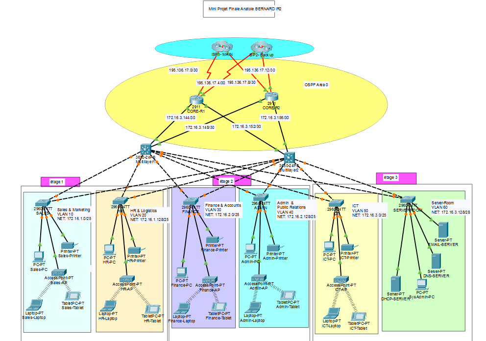
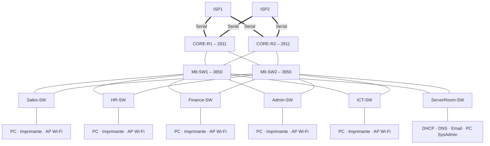

# Réseau d'entreprise multi-départements – Mini projet final

Mini projet final réalisé à l'ESAIP (IR2) : conception d'un réseau d'entreprise complet sous Cisco Packet Tracer, avec cœur de réseau redondant, double accès opérateur, segmentation par département, services centralisés et sécurisation des équipements.

## Architecture

### Capture Packet Tracer

### Schéma logique

Architecture en trois niveaux :

- **Accès** : un switch 2960 par département, chacun relié aux **deux** switchs de distribution (double uplink trunk).
- **Distribution / cœur** : deux switchs multicouches 3650 (routage inter-VLAN par SVI) reliés en liens routés /30 aux deux routeurs de bordure.
- **Bordure** : deux routeurs 2911 connectés chacun aux **deux** fournisseurs d'accès (4 liaisons série).

## Plan d'adressage (VLSM)

| VLAN | Département | Réseau | Passerelle (SVI) |
|---|---|---|---|
| 10 | Sales | 172.16.1.0 /25 | 172.16.1.1 |
| 20 | HR | 172.16.1.128 /25 | 172.16.1.129 |
| 30 | Finance | 172.16.2.0 /25 | 172.16.2.1 |
| 40 | Admin | 172.16.2.128 /25 | 172.16.2.129 |
| 50 | ICT | 172.16.3.0 /25 | 172.16.3.1 |
| 60 | ServerRoom | 172.16.3.128 /28 | 172.16.3.129 |
| 99 | BlackHole | – | ports inutilisés |

| Liens | Réseaux |
|---|---|
| Distribution ↔ cœur | 172.16.3.144/30, .148/30, .152/30, .156/30 |
| Cœur ↔ FAI | 195.136.17.0/30, .4/30, .8/30, .12/30 |

| Serveur | Adresse |
|---|---|
| DHCP | 172.16.3.130 |
| DNS (`www.gtech.com`) | 172.16.3.131 |
| PC SysAdmin | 172.16.3.132 |

## Fonctionnalités configurées

**Routage et redondance**
- OSPF (processus 10, aire 0) sur l'ensemble des routeurs et switchs multicouches, router-ID fixés.
- Routes par défaut principales et **routes flottantes** de secours (distance administrative 70) vers le second FAI / le second routeur.
- **NAT/PAT** (`overload`) sur les routeurs de bordure pour l'ensemble des sous-réseaux internes (ACL standard 1).

**Services**
- Serveur **DHCP** centralisé : un pool par département, relayé via `ip helper-address` sur chaque SVI.
- Serveur **DNS** (enregistrement A `www.gtech.com`), serveur mail, services HTTP/FTP.
- Un point d'accès Wi-Fi par département avec SSID dédié.

**Sécurité**
- Accès d'administration en **SSH v2** uniquement (`transport input ssh`, `login local`), domaine `cisco.net`.
- `service password-encryption`, mots de passe console, bannière MOTD.
- Ports inutilisés placés dans un VLAN **BlackHole** (99) et désactivés.
- **Port-security** avec apprentissage *sticky* des adresses MAC sur le switch Finance.

Toutes les configurations sont regroupées dans [`CONFIGURATIONS.md`](CONFIGURATIONS.md).

## Compétences mises en œuvre

Conception hiérarchique · VLSM · VLAN et trunks · routage inter-VLAN sur switch multicouche · OSPF · routes statiques flottantes · NAT/PAT · DHCP relay · DNS · SSH · port-security · durcissement des équipements Cisco.

## Utilisation

Ouvrir [`mini-projet-final.pkt`](mini-projet-final.pkt) avec **Cisco Packet Tracer 9.0** ou plus récent (fichier enregistré sous la version 9.0). Testé sous Packet Tracer 9.0 : les postes obtiennent leur adresse en DHCP et joignent le serveur DNS (`ping www.gtech.com`) ainsi que les FAI. Commandes de vérification utiles : `show ip ospf neighbor`, `show ip route`, `show ip nat translations`, `show port-security`, `ipconfig /renew` sur les postes.

## Contenu du dossier

| Élément | Description |
|---|---|
| [`mini-projet-final.pkt`](mini-projet-final.pkt) | Fichier Cisco Packet Tracer du projet |
| [`CONFIGURATIONS.md`](CONFIGURATIONS.md) | Configuration de chaque équipement et adressage des postes, en un seul fichier |
| [`configs/`](configs/) | Une configuration brute par équipement (`.txt`) |
| [`images/`](images/) | Captures de la topologie |

## Auteur

**Anatole BERNARD** – étudiant ingénieur à l'ESAIP
